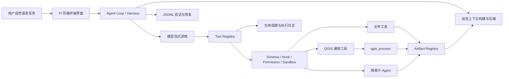

# Geo-agent（CityBrain）项目亮点与实现方式

> 文档性质：当前项目工作树的技术亮点提炼与实现说明  
> 核验日期：2026-10-09  
> 核验范围：`src/`、`package.json`、`README.md` 及项目内主要设计文档  
> 说明：本文以当前源码为准；规划文档、历史构建产物和尚未落地的设计不计入“已实现”。

## 1. 项目定位

Geo-agent（包名与 CLI 名称为 `citybrain`）是一个面向城市数据分析与空间治理场景的 TypeScript CLI Agent。它将大模型对话、工具调用、QGIS Processing、工作区安全、上下文管理、会话恢复和执行观测组织在同一套终端工作流中，使用户可以用自然语言驱动本地空间分析任务。

项目的核心思路不是为数百个 QGIS 算法分别编写工具，而是以 `qgis_process` 为统一适配层，让 Agent 按照“检索算法 → 查询参数 → 执行算法 → 校验产物”的路径动态使用 QGIS Processing 能力。

截至核验日期，项目已形成可运行的 MVP：共 69 个 TypeScript 源文件、约 1.46 万行源码，并通过 `npm run check` 的 TypeScript 静态检查。

## 2. 核心架构



主链路可以概括为：

1. CLI 接收用户目标，并以流式方式显示模型文本、thinking、工具状态和人工确认界面。
2. Agent Loop 在每轮请求前重建动态 System Prompt，并根据上下文预算投影、裁剪或摘要历史消息。
3. 模型发起工具调用后，Tool Registry 统一执行输入校验、规范化、Hook、权限判断、Sandbox 检查、产物预登记和错误封装。
4. QGIS 工具通过 `qgis_process` 查询或运行算法；文件工具在工作区中安全读写；子 Agent 在独立会话中执行委派任务。
5. 工具结果、产物状态、上下文使用量和 Harness 状态被记录，结果重新进入模型上下文，直至生成最终答复。

## 3. 目前最值得强调的项目亮点

### 3.1 以通用适配器覆盖 QGIS Processing，而非逐算法封装

**亮点价值**

- 避免为数百个 QGIS 算法维护大量重复包装代码。
- 算法能力随本地 QGIS Provider 扩展，可适配不同 QGIS 安装环境。
- 将算法发现、参数理解和实际执行组成完整闭环，适合开放式空间分析任务。

**实现方式**

- `list_qgis_algorithms` 调用 `qgis_process list --json`，将 Provider 目录拍平成统一的算法摘要，并支持关键字过滤和结果截断。
- `describe_qgis_algorithm` 调用 `qgis_process help <algorithm> --json`，解析参数与输出；旧版本不支持 JSON 时退回文本结果。
- `run_qgis_algorithm` 把通用参数对象序列化为 `KEY=VALUE`，执行 `qgis_process run <algorithm> -- ...`。
- 执行完成后解析 `Result:` 和 `OUTPUT` 信息，识别输出路径，并检查预期文件是否真实存在；进程成功但产物缺失时仍判定任务未正确完成。
- 输入类参数通过 Sandbox 解析为可读路径，`OUTPUT*` 参数解析为工作区内可写路径，`TEMPORARY_OUTPUT` 保留给 QGIS 自身处理。

**关键代码**

- `src/integrations/qgis/qgis-process-client.ts`
- `src/tools/list-qgis-algorithms/index.ts`
- `src/tools/describe-qgis-algorithm/index.ts`
- `src/tools/run-qgis-algorithm/implementation.ts`

### 3.2 针对 Windows QGIS 环境做了工程级兼容

**亮点价值**

QGIS 在 Windows 上通常通过 `.bat` 初始化 OSGeo4W、GDAL、PROJ 和 Qt 等环境。直接经由批处理透传带空格的参数容易产生引号问题，项目没有停留在“能启动命令”的层面，而是专门处理了真实运行环境中的路径可靠性。

**实现方式**

- 首次运行时调用 QGIS 包装脚本并捕获完整环境变量。
- 根据 `OSGEO4W_ROOT`、`QGIS_PREFIX_PATH` 和安装风格定位真正的 `qgis_process.exe`。
- 后续优先直接 `spawn` 可执行文件，同时复用捕获到的 QGIS 环境，获得更可靠的 Windows 参数传递。
- 无法定位真实可执行文件时，才退回 `cmd /c call <wrapper.bat>`。
- 查询默认超时 120 秒，算法执行默认超时 10 分钟；支持 `AbortSignal` 取消，并每秒上报 stdout/stderr 尾部进度。

**关键代码**

- `src/integrations/qgis/qgis-process-client.ts`
- `src/integrations/qgis/qgis-runtime.ts`
- `src/integrations/qgis/qgis-setup.ts`

### 3.3 Agent Loop 具备明确状态、持续工具调用和失控保护

**亮点价值**

项目不是简单的“一次请求—一次回复”，而是可持续执行多轮工具调用的 Agent Harness。它能把模型输出、工具结果、状态变化和最终答复组织为一个可观测的执行循环，同时防止模型陷入无限调用。

**实现方式**

- `AgentLoop.run()` 以 `AsyncGenerator` 输出文本、thinking、工具进度、上下文用量和 Harness 状态，UI 可增量消费。
- Harness 状态覆盖 planning、streaming、waiting、executing、finalizing、completed、failed、aborted 等阶段。
- 模型一次返回的多个工具调用交给 `StreamingToolExecutor` 调度；工具失败以结构化结果回传模型，不直接打断整个 Agent Loop。
- 单次任务最多允许 12 轮工具调用；完全相同的工具批次连续出现 3 次后进入强制收尾。
- 收尾阶段移除全部工具定义，并要求模型仅基于已有结果给出完成情况、未完成项和下一步；模型仍不能正确收尾时生成确定性 fallback。

**关键代码**

- `src/agent/agent-loop.ts`
- `src/harness/harness-controller.ts`
- `src/harness/harness-state-machine.ts`
- `src/tools/core/execution/streaming-tool-executor.ts`

### 3.4 工具层从“函数集合”升级为统一契约和生命周期管线

**亮点价值**

统一 ToolSpec 让文件工具、QGIS 工具和子 Agent 使用同一套执行约束。新增工具时只需声明定义、运行函数和元数据，不必重复实现校验、安全、日志、产物和 Hook 逻辑，降低了后续扩展成本。

**实现方式**

Tool Registry 的关键执行顺序为：

```text
解析工具
  → JSON Schema 校验
  → 输入规范化
  → 领域校验
  → 重新校验
  → Before Hook
  → 推导读写路径与预期产物
  → Sandbox / Permission 决策
  → 产物登记为 pending
  → 执行业务函数并流式上报进度
  → After Hook
  → 完成或结构化失败
```

工具元数据可声明来源、只读性、破坏性、并发安全性、中断行为、读写路径、产物路径、结果大小限制和展示摘要。Hook 可以补充上下文、修改输入、阻止执行或要求当前 Agent 进入收尾阶段。

**关键代码**

- `src/tools/core/contracts/tool-spec.ts`
- `src/tools/core/contracts/tool-contract.ts`
- `src/tools/core/contracts/tool-preflight.ts`
- `src/tools/core/execution/tool-registry.ts`
- `src/tools/index.ts`

### 3.5 项目级 Sandbox 将“可读范围”和“可写范围”分离

**亮点价值**

空间分析任务经常要读取外部原始数据，但结果必须落在受控项目目录。项目将这两种权限分开建模，既满足真实数据处理需要，又避免 Agent 任意修改工作区外文件。

**实现方式**

- 默认将项目根目录作为写入边界；外部目录只能作为显式授权的只读根目录加入。
- 相对路径分别以项目目录、控制目录或 Sandbox 根目录解析，避免不同工具各自猜测路径基准。
- 写入时检查最近存在的父目录，并解析真实路径，防止通过 symlink/junction 把写操作重定向到工作区外。
- QGIS 子进程的 `TEMP`、`TMP`、`TMPDIR` 被定向到 Harness 管理的 `.internal/tmp`。
- `AGENT(S).md`、`workspace.json`、`profile.md` 和 `.internal` 等 Harness 管理文件禁止由通用文件工具直接修改。

**关键代码**

- `src/workspace/sandbox-policy.ts`
- `src/workspace/workspace.ts`
- `src/tools/core/security/permission-coordinator.ts`
- `src/tools/core/shared/file-write-utils.ts`

### 3.6 文件修改采用“先读后写 + 乐观并发 + 原子替换”

**亮点价值**

这套机制降低了模型基于过期内容覆盖用户修改、局部替换命中错误位置，以及写入中断导致文件损坏的风险。

**实现方式**

- `read_file` 在完整读取时记录文件大小、修改时间和内容哈希快照。
- 修改已有文件前，`write_file` / `edit_file` 要求存在完整读取快照，并重新校验哈希、大小和修改时间。
- `edit_file` 默认要求旧字符串唯一命中；多处命中时必须增加上下文或显式启用 `replace_all`。
- 写入使用同目录临时文件、文件同步和原子 rename，最后清理临时文件。
- 保留原文件的换行风格，减少无意义 diff。

**关键代码**

- `src/tools/read-file/index.ts`
- `src/tools/write-file/index.ts`
- `src/tools/edit-file/index.ts`
- `src/tools/core/shared/file-write-utils.ts`

### 3.7 上下文管理同时解决缓存稳定性和长任务膨胀

**亮点价值**

项目没有把全部历史消息和运行状态无差别塞入 Prompt，而是区分稳定规则、项目上下文和实时状态，并针对大型工具输出与长对话设置分层预算。这一点对 QGIS 目录查询、算法帮助和长日志等高体积结果尤其重要。

**实现方式**

- System Prompt 分为 static、dynamic、volatile 三层，并使用显式边界标记维持稳定前缀，便于 Prompt Cache 命中。
- volatile 层在每次模型请求前重建，可包含当前任务、QGIS Runtime、Artifact 状态、工作目录和日期。
- 对不同工具设置独立结果预算：例如算法列表 8K token、算法描述 12K token、单批工具结果总预算 16K token。
- 超预算的完整工具结果持久化到工作区，Prompt 中只保留摘要、预览和落盘位置；替换记录写入 Session，后续请求复用相同投影，避免上下文来回抖动。
- 请求仍超预算时依次执行历史裁剪、旧工具结果 microcompact、context collapse、LLM 摘要；LLM 摘要失败时使用确定性摘要 fallback。
- 压缩作用于本次请求投影，不直接破坏 JSONL 中保存的 canonical conversation。

**关键代码**

- `src/context/context-assembly.ts`
- `src/context/context-builder.ts`
- `src/context/context-projection.ts`
- `src/context/context-compression.ts`
- `src/context/tool-result-store.ts`
- `src/context/context-trace-log.ts`

### 3.8 产物状态与执行日志使空间任务可验证、可追踪

**亮点价值**

空间分析不能只依据进程退出码判断成功。项目把输出文件视为有生命周期的 Artifact，并把工具状态、进度、权限、Hook 和错误写入结构化日志，使“模型说完成了”和“文件确实生成了”可以被区分。

**实现方式**

- 工具执行前将预期输出登记为 `pending`。
- 成功验证后转为 `ready`；缺失或生产者失败时转为 `missing` / `invalid`。
- Artifact 摘要会重新注入动态上下文，让后续模型轮次知道哪些结果已经可用。
- 工具执行日志、上下文用量日志和实际请求追踪分别落入工作区 `.internal/logs`。
- 日志覆盖 start、progress、artifact、lifecycle、finish，以及 Harness state、人工交互和恢复决策。

**关键代码**

- `src/tools/core/artifacts/artifact-registry.ts`
- `src/tools/core/observability/tool-execution-log.ts`
- `src/context/context-usage-log.ts`
- `src/context/context-trace-log.ts`

### 3.9 子 Agent 使用独立会话和受限工具集完成任务隔离

**亮点价值**

主 Agent 可以把数据检查、算法选择或结果验证等子任务委派出去，同时避免把子 Agent 的完整过程污染主对话上下文。

**实现方式**

- 每次委派创建新的 `SessionManager` 和 `AgentLoop`，历史上下文为空。
- 子 Agent 继承主任务的模型、认证、Sandbox、QGIS Runtime、日志和人工确认能力。
- 子 Agent 仅获得文件工具和 QGIS 工具，不获得 `delegate`，从结构上禁止递归创建更多子 Agent。
- 主 Agent只接收最终结果和状态，不读取子 Agent 的中间 transcript。
- 委派工具被标记为非并发安全并独占执行，避免共享运行时状态相互干扰。

**关键代码**

- `src/tools/delegate/index.ts`
- `src/app/interactive-app.ts`

### 3.10 JSONL 会话保留执行上下文并支持恢复

**亮点价值**

对于耗时较长、需要多轮数据处理的空间分析任务，会话恢复比单次聊天更重要。JSONL 追加式存储既便于逐条落盘，也便于排查模型、工具和压缩行为。

**实现方式**

- 会话按工作目录隔离，以 JSONL 保存消息、模型切换、压缩边界和工具结果替换记录。
- 支持创建新会话、恢复最近会话、列出会话和打开指定会话。
- 空白会话不会立即创建文件，避免产生无意义记录。
- 上下文恢复从最近压缩边界开始，组合摘要、保留消息和后续增量消息。

**关键代码**

- `src/session/session-manager.ts`
- `src/session/session-types.ts`
- `src/app/shell-commands.ts`

## 4. 技术实现总结

| 层级 | 已实现能力 | 主要实现手段 |
|---|---|---|
| 交互层 | 流式文本、thinking、工具状态、人工确认、双 `Ctrl+C` 退出 | `pi-tui` + AsyncGenerator 事件流 |
| Agent 层 | 多轮工具调用、Harness 状态、失败恢复、强制收尾 | `AgentLoop` + `HarnessController` |
| 工具层 | 统一注册、校验、Hook、权限、产物、错误封装 | ToolSpec + Tool Registry + Streaming Executor |
| QGIS 层 | 算法检索、描述、执行、进度、取消、产物校验 | `qgis_process` 通用适配器 |
| 文件层 | 受控读写、精确编辑、并发冲突检测、原子替换 | 快照哈希 + Sandbox + 临时文件 rename |
| 上下文层 | 分层 Prompt、工具结果预算、持久化投影、多阶段压缩 | static/dynamic/volatile + projection/compression |
| 工作区层 | 写边界、外部只读授权、链接逃逸防护、临时目录隔离 | `SandboxPolicy` + Permission Coordinator |
| 观测层 | 工具、生命周期、产物、Token、真实请求追踪 | 多类 JSONL Logger |
| 会话层 | 会话追加存储、恢复、压缩与替换记录 | JSONL `SessionManager` |
| 协作层 | 子 Agent 委派与上下文隔离 | 独立 Session/Loop + 受限 Tool Registry |

## 5. 一条典型空间分析任务如何落地

以“对道路数据做 500 米缓冲并保存结果”为例：

1. Agent 使用 `list_qgis_algorithms` 搜索 buffer 类算法。
2. 使用 `describe_qgis_algorithm` 获取 `native:buffer` 的输入、距离和输出参数定义。
3. Tool Registry 校验调用参数，推导输入路径、输出路径和预期 Artifact。
4. Sandbox 确认输入位于允许读取范围，输出位于项目写入根目录。
5. Artifact Registry 将输出登记为 `pending`。
6. QGIS 客户端在捕获的本地 QGIS 环境中执行算法，并持续上报运行时间及输出尾部。
7. 执行结束后解析 QGIS 返回值，并检查输出文件是否存在。
8. 文件存在则 Artifact 转为 `ready`；否则标记缺失并将结构化错误交回模型修正。
9. Agent 基于真实产物状态生成最终答复，会话和执行轨迹同步写入 JSONL。

这条链路体现了项目的主要特点：自然语言只是入口，真正的可靠性来自工具契约、安全边界、运行状态和结果验证。

## 6. 当前实现边界与风险

以下内容不应包装为已经完整实现：

- `profile.md` 自动画像 Worker 尚未形成完整后台闭环；当前主要是规范和上下文入口。
- 过程数据与最终结果尚未根据任务语义自动路由到不同目录。
- Sandbox 是应用层路径策略，不是容器或操作系统级隔离。
- Docker QGIS Runtime 和远程 QGIS Runner 尚未实现。
- 对 Shapefile、GeoPackage、栅格、CSV 等数据的确定性元数据扫描仍需继续完善。
- 子 Agent 已实现隔离委派，但还不是可持久调度、可恢复的多 Agent 编排平台。
- `package.json` 当前没有自动化测试脚本；本次核验只确认 `npm run check` 通过，不能替代单元测试、集成测试和真实 QGIS 回归测试。
- 当前工作树正在进行工具目录与核心契约重组，存在已修改、删除和新增但尚未提交的文件；本文描述的是 2026-10-09 的工作区状态，而不是最近 Git 提交 `0e15824` 的纯净快照。
- `PROJECT_DOCUMENTATION.md` 中“QGIS 仅实现 Runtime 检测、尚不能执行算法”的结论已经过时；当前 `src/integrations/qgis` 与 `src/tools/*qgis*` 已包含查询、描述和执行实现。

## 7. 可用于对外介绍的精炼表述

### 一句话版本

基于 TypeScript 构建面向城市空间分析的 CLI Agent，以 `qgis_process` 通用适配 QGIS Processing，并通过统一工具生命周期、项目级 Sandbox、Artifact 校验和分层上下文压缩，实现自然语言到可执行、可验证地理处理流程的闭环。

### 技术亮点版本

- 设计 QGIS 通用工具链，通过算法检索、参数描述与动态执行覆盖本地 Processing 能力，避免逐算法封装。
- 构建 ToolSpec/Tool Registry 执行框架，统一处理 Schema 校验、Hook、权限、Sandbox、进度、错误与 Artifact 生命周期。
- 针对 Windows QGIS 包装脚本捕获 OSGeo4W 环境并直启 `qgis_process.exe`，解决复杂路径和参数透传问题。
- 实现 static/dynamic/volatile 分层 Prompt、超大工具结果持久化和多阶段上下文压缩，支撑长链路空间分析任务。
- 通过读快照、内容指纹、原子替换和 symlink/junction 边界检查，提高 Agent 文件操作的安全性与一致性。
- 实现 JSONL 会话恢复、结构化执行日志、产物状态追踪和隔离子 Agent，为后续复杂任务编排提供工程基础。

## 8. 结论

Geo-agent 当前最突出的价值并不只是“让大模型调用 QGIS”，而是围绕这一目标补齐了较完整的 Agent 工程底座：模型循环、统一工具契约、安全执行、长任务进度、结果校验、上下文控制、会话恢复和日志追踪已经在同一套源码中协同工作。

从成熟度看，项目适合定位为“可运行的空间分析 Agent MVP + 持续演进中的 Harness 基础设施”。对外描述时应突出通用 QGIS 适配、工具生命周期、安全与上下文工程；同时保留对自动画像、系统级隔离、远程 Runtime 和测试体系尚未完善的边界说明。

