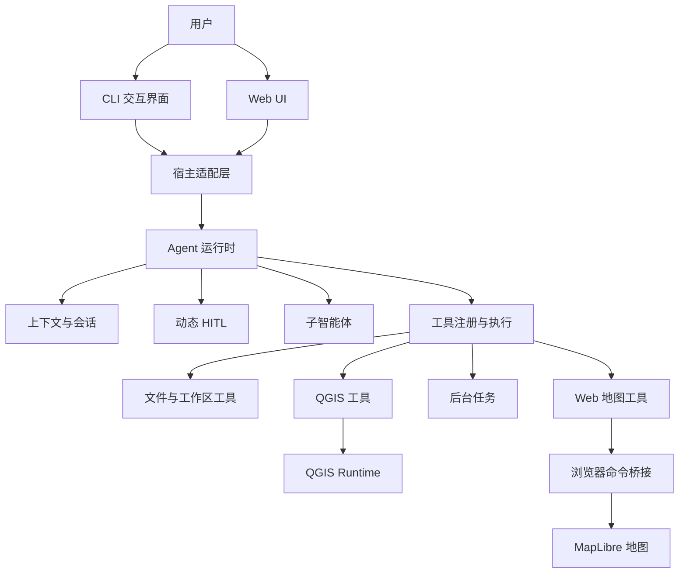

# CityBrain：面向空间数据处理的智能体

CityBrain 是一个面向空间数据处理、分析与可视化场景的本地智能体项目。它将大语言模型、QGIS 处理能力、工作区文件系统、后台任务、人工确认机制和 WebGIS 界面组合到统一运行时中，使用户可以通过自然语言完成空间数据检查、处理、制图和结果管理。

项目同时提供两种交互方式：

- **命令行模式**：适合开发、调试、批处理和低资源环境。
- **Web UI 模式**：适合地图交互、图层管理、文件预览和可视化分析。

两种模式共享同一套 Agent 核心、会话、工具执行与安全机制，但会根据宿主环境装配不同的系统提示词、运行时状态和工具集合。例如，地图状态和地图控制工具只会在 Web UI 模式中提供给模型。

> 当前项目处于持续开发阶段，核心链路已经可用，部分高级能力仍在演进。已知限制请参见本文末尾的“当前限制”。

## 快速开始

安装 Node.js `22.19` 或更高版本后，通过 npm 全局安装：

```bash
npm install --global citybrain-agent
```

安装完成后，在任意目录启动：

```bash
citybrain
```

也可以直接选择运行模式：

```bash
citybrain cli
citybrain web
```

Web UI 默认打开 `http://127.0.0.1:3170`。QGIS 是空间处理、格式转换和部分地图能力的可选运行时，可以在首次启动后配置。

## 项目定位

传统的 GIS 自动化通常要求用户掌握数据格式、坐标系、处理算法和命令参数。CityBrain 希望在这些专业能力之上增加一层自然语言交互，让用户可以描述目标，由 Agent 完成任务拆解、工具选择、参数组织、结果检查和可视化呈现。

项目主要解决以下问题：

- 如何让大语言模型安全地访问本地空间数据和项目文件。
- 如何将大量 QGIS 算法以可发现、可描述、可执行的方式提供给模型。
- 如何让耗时工具在前台等待一段时间后自然升级为后台任务。
- 如何让 Agent 感知当前地图、图层、视口和已打开的可视化内容。
- 如何在参数不明确、操作危险或执行失败时动态请求用户决策。
- 如何同时支持 CLI 与 Web UI，而不复制两套 Agent 业务逻辑。

## 架构分层

CityBrain 采用“核心运行时与交互界面解耦”的分层架构。CLI 和 Web UI 不是两套独立应用，而是同一 Agent Runtime 的不同宿主。



### 1. 交互层

负责接收用户输入和呈现执行结果。

- CLI 提供会话、模型、QGIS、沙箱等命令。
- Web UI 提供会话管理、项目目录、地图、文件可视化、问答和设置页面。
- Web UI 中的工具调用、后台状态和 HITL 请求直接显示在对话流中，不使用浏览器原生弹窗打断交互。

### 2. 宿主适配层

负责描述当前运行环境，并决定模型在该模式下能够看到什么。

- 组装 CLI、Web 或 API 对应的系统提示词。
- 根据模式选择工具集合。
- 注入地图状态、可视化标签页等动态上下文。
- 将 Agent 事件转换为终端输出、HTTP 响应、SSE 事件或浏览器命令。

### 3. Agent 运行时层

负责模型推理与工具调用的主循环。

- 管理消息历史和多轮会话。
- 调度模型请求和工具调用。
- 处理工具结果、人工输入和后台完成通知。
- 在上下文接近上限时执行分阶段压缩。
- 为子智能体创建隔离的执行上下文。

### 4. 工具执行层

负责工具注册、参数校验、执行状态和结果回传。

- 统一工具协议，避免模型直接依赖底层实现。
- 长耗时工具可在等待阈值后转为后台任务。
- 工具完成通知会重新注入 Agent 会话，无需模型反复轮询。
- 记录执行日志，便于定位参数错误、超时和运行时异常。

### 5. GIS 与可视化层

负责空间数据处理和地图交互。

- QGIS Runtime 提供算法发现、参数描述和算法执行。
- Web 地图工具提供视口读取、图层检查、图层管理和视图控制。
- 矢量与栅格数据经过统一的地图产物链路加载到 MapLibre。
- 地图命令由服务端发出，浏览器实际执行并确认，避免服务端状态与真实地图不一致。

### 6. 数据与安全层

负责约束本地文件访问和保存运行状态。

- 每个会话关联明确的工作区，而不是自动指向项目源码目录。
- 文件工具遵守工作区沙箱和额外只读目录规则。
- 写入前要求先读取，降低误覆盖风险。
- 临时文件、处理结果、日志和内部状态分目录保存。

## 核心能力

### CLI 与 Web UI 双模式

直接运行项目时可以选择进入 CLI 或 Web UI，也可以通过启动参数明确指定模式。两种模式共享模型配置、QGIS Runtime、工具执行器和会话基础设施。

Web UI 默认提供三栏工作区：

- 左侧：会话列表、项目目录和设置入口。
- 中间：不可移除的地图标签页，以及 Markdown、HTML、CSV、JSON、文本和图片等可关闭的可视化标签页。
- 右侧：Agent 对话、工具执行过程、后台状态和 HITL 交互。

### QGIS 算法接入

项目没有将每个 QGIS 算法硬编码成独立工具，而是通过三个元工具提供算法能力：

- `list_qgis_algorithms`：检索可用算法。
- `describe_qgis_algorithm`：读取算法说明和参数约束。
- `run_qgis_algorithm`：执行选定算法。

这种方式可以控制模型工具数量，同时覆盖 QGIS Processing 中的大量算法。

### 矢量、栅格与三维数据加载

Web UI 支持将常见地理数据加载到地图：

- GeoJSON、JSON：可以直接作为矢量数据读取。
- Shapefile、GPKG、KML、GML：通过 QGIS 转换并重投影为 EPSG:4326 的 GeoJSON 地图产物。
- TIF、TIFF、VRT、IMG、ASC：通过 QGIS 重投影并生成二维栅格产物；DEM 还可进一步生成 Terrain RGB 瓦片用于三维地形。
- glTF、GLB、OBJ：作为独立三维模型加载；添加时需要提供 WGS84 经度、纬度，可选高程、缩放和旋转参数。
- 3D Tiles：支持本地或 HTTP(S) `tileset.json`，使用数据自身的空间参考定位，也可提供局部偏移量。

地图不会因为工作区中新生成了地理文件就自动加载。图层必须由用户操作或 Agent 明确调用地图工具添加，避免地图被无关中间产物污染。

### AI 驱动的图层可视化

当前 Web 地图工具包括：

| 工具 | 作用 |
| --- | --- |
| `map_get_state` | 获取视口、图层和选择状态 |
| `map_inspect_layer` | 检查图层字段、数据类型和统计信息 |
| `map_manage_layer` | 添加、移除、更新和可视化二维图层、三维模型与 3D Tiles |
| `map_control_view` | 缩放、定位和调整地图视图 |

`map_manage_layer` 通过 `operation` 参数统一图层操作，避免为添加、删除、显隐、改名和样式分别暴露大量细碎工具。

矢量可视化支持简单样式、分类样式和分级样式；栅格可视化支持灰度、RGB、色带、阴影和 DEM 三维地形模式。三维地形通过 `terrain` 模式启用，并可用 `exaggeration` 调整垂直夸张。独立三维模型和 3D Tiles 由 Three.js 渲染层与 MapLibre 相机同步；模型可以先检查二维图层，再根据字段、数据类型和用户目标生成可视化方案。

例如，Web 模式下可以要求 Agent“在经度 104.06、纬度 30.67 加载这个 GLB，缩放为 0.8”，或“加载工作区中的 `tileset.json` 并缩放到该图层”。本地三维资源仍受工作区沙箱约束；远程资源必须允许浏览器跨域访问。

### 长耗时工具后台化

QGIS 等工具可能执行数分钟。项目采用“同一次执行自动移交”的后台任务机制：

1. 工具先正常执行，前台等待最长 1 分钟。
2. 如果在阈值内完成，直接返回结果。
3. 如果仍在运行，将原执行句柄登记为后台任务，而不是重新执行工具。
4. 前端显示任务仍在运行，当前 Agent Run 保持活跃并允许用户取消。
5. 如果模型暂时没有继续调用工具，但本轮仍有关联后台任务，Agent Loop 不会结束。
6. 任务进入终态后，结果以隐藏的 `<task-notification>` 回注同一个 Loop，模型继续完成原始请求。

这种方式不会通过简单替换线程实现，也不会因为升级后台任务而重复执行同一个外部进程。内部运行时可以等待任务 Promise，但模型侧不提供会消耗额外轮次的 `wait_task` 工具；只有当本轮不存在未消费的后台结果且模型没有新的工具调用时，对话才真正结束。

### 动态 HITL

当用户意图不完整、存在多个合理方案、操作具有破坏性或工具失败需要选择恢复方式时，Agent 可以动态生成 HITL 请求。

当前交互类型包括：

- 澄清问题。
- 单选或多方案选择。
- 普通确认。
- 危险操作确认。
- 失败后的恢复路径选择。

Web UI 将请求嵌入当前对话；CLI 则在终端中等待输入。用户的选择会作为结构化结果返回原有执行链路。

### 子智能体

主 Agent 可以通过 `delegate` 的 `subagent_type` 将边界清晰的子任务委派给两种内置子智能体：`data-explorer` 用于只读数据探查，`spatial-planner` 用于只读空间分析方案规划。主 Agent 需要在 `prompt` 中提供自包含的任务背景，子智能体最终只回传文字结果。

当前实现禁止子智能体继续递归创建子智能体，用于限制调用深度和资源消耗。每次委派使用纯内存临时会话：执行期间仍有独立上下文，完成后不会留下普通会话文件，也不会显示在 Web 会话列表中。

两类子智能体都只能读取文件，不具备文件写入、QGIS 处理执行、地图操作、后台任务管理或再次委派的权限。`spatial-planner` 额外可以只读查询和描述 QGIS 算法；实际执行仍由主 Agent 负责。二进制地理数据的字段、高程等内容不能通过文本 `read_file` 直接核实，应结合已有画像或由主 Agent 使用合适工具验证。

### 对话后工作区数据画像

一次主对话正常完成后，运行时会提交独立的工作区画像任务。它不是 `delegate` 子智能体，也不会再次调用大模型：调度器把任务状态写入磁盘后启动独立 Node.js Worker，主对话立即返回；即使前台进程随后退出，Worker 仍可继续生成画像。

画像采用“内部结构化状态 + Agent 可读投影”的双层组织：

```text
project/citybrain/
├─ profile.md                         # Agent 可通过 read_file 读取的汇总
└─ .internal/profiles/
   ├─ index.json                      # 数据集索引、指纹与画像版本
   ├─ datasets/*.json                 # 单个数据集的结构化画像
   └─ jobs/*.json                     # 可恢复的后台任务状态
```

- 只重算本轮新建或修改的产物，文件大小和修改时间未变化时直接复用已有画像。
- 首次运行及周期性对账会扫描工作区，补获用户在 Agent 外部添加、修改或删除的数据。
- 矢量和栅格优先使用 QGIS/GDAL 提取 CRS、字段、范围、波段和统计量；CSV/TSV、Markdown/HTML、glTF/GLB/OBJ 与 3D Tiles 使用轻量流式或结构解析器。
- `.internal` 是机器状态来源，`profile.md` 每次从索引重新投影，因此既支持局部更新，也不会要求模型读取内部目录。
- 无实际数据变化时不会递增画像版本或反复改写 `profile.md`。
- Worker 使用文件锁串行处理同一工作区队列，并持久化 `queued / running / completed / failed` 状态；异常退出后可恢复排队任务和超时的运行中任务。

可运行 `npm run smoke:profile` 验证独立 Worker、增量画像和“不生成普通会话文件”三个关键约束。

### 上下文管理

项目将上下文分为三类：

- 静态上下文：系统规则、宿主能力和工具说明。
- 动态上下文：当前工作区、地图图层、可视化标签页等状态。
- 易变上下文：正在执行的任务、一次性通知和临时交互状态。

地图状态只记录中心点、缩放级别、图层元数据和选择信息，不会把完整 GeoJSON、Markdown 或 CSV 内容塞入系统提示词。这样既保留界面感知能力，也避免上下文迅速膨胀。

## 分层安装与配置

### 第一层：基础环境

必需环境：

- Windows、Linux 或 macOS。
- Node.js `22.19` 或更高版本。
- npm。

检查版本：

```bash
node --version
npm --version
```

### 第二层：安装 CityBrain

普通用户推荐通过 npm 全局安装：

```bash
npm install --global citybrain-agent
```

安装后可以使用以下命令确认版本：

```bash
citybrain --version
```

需要升级时执行：

```bash
npm update --global citybrain-agent
```

如果只是临时体验，不希望全局安装，也可以执行：

```bash
npx --yes citybrain-agent@latest
```

项目开发者可以从源码安装：

```bash
git clone https://github.com/forgiser/citybrain-agent.git
cd citybrain-agent
npm install
```

如果只需要体验基础对话、文件工具和 Web UI，可以先不配置 QGIS；空间处理、格式转换和部分地图加载能力需要 QGIS Runtime。

### 第三层：配置模型服务

首次进入应用后，在 CLI 命令或 Web 设置页面中配置：

- 模型服务商。
- API Key。
- API 地址或服务端点。
- 默认模型。
- 推理强度等 Agent 参数。

Web UI 的“设置 → 模型服务”会连接真实配置存储，不只是静态表单。敏感认证信息保存在用户级配置目录中，不写入项目工作区。

### 第四层：配置 QGIS（可选但推荐）

安装 QGIS 后，需要让 CityBrain 找到可运行的 `qgis_process`，也可以选择 QGIS 提供的 `.bat` 启动脚本。

支持两种配置方式：

- Web UI：进入“设置 → QGIS”，从文件系统选择实际的 QGIS 批处理文件并应用。
- CLI：使用 `/qgis detect` 自动检测，或使用 `/qgis use <path>` 指定运行入口。

常见 Windows 安装位置示例：

```text
C:\Program Files\QGIS 3.xx.x\bin\qgis_process-qgis.bat
C:\OSGeo4W\bin\qgis_process-qgis.bat
```

配置后可以通过算法列表或算法详情验证 QGIS 是否可用。

> 当前主要支持本机 QGIS 运行时。Docker 和远程 QGIS 服务仍在规划中。

### 第五层：选择运行模式

#### npm 全局安装后交互选择模式

```bash
citybrain
```

启动后根据提示选择 CLI 或 Web UI。

#### 直接进入 CLI

```bash
citybrain cli
```

#### 直接进入 Web UI

```bash
citybrain web
```

可以指定 Web 服务端口：

```bash
citybrain web --port 3180
```

Web 服务默认地址：

```text
http://127.0.0.1:3170
```

从源码开发时使用：

```bash
npm run dev
npm run dev:cli
npm run dev:web
npm run dev -- --mode web --port 3180
```

## 首次使用流程

### CLI 模式

1. 启动 CLI。
2. 配置模型服务。
3. 创建或恢复会话。
4. 明确选择工作区。
5. 使用自然语言描述文件处理或空间分析任务。

CLI 常用命令：

| 命令 | 作用 |
| --- | --- |
| `/help` | 查看命令帮助 |
| `/new` | 创建新会话 |
| `/resume` | 恢复已有会话 |
| `/clear` | 清空当前对话 |
| `/model [provider/model]` | 查看或切换模型 |
| `/thinking [off\|high\|max]` | 设置推理强度 |
| `/qgis detect` | 自动检测 QGIS |
| `/qgis list [filter]` | 查询 QGIS 算法 |
| `/qgis info <algorithm>` | 查看算法参数 |
| `/qgis use <path>` | 指定 QGIS 运行入口 |
| `/workspace` | 查看、创建或切换工作区 |
| `/workspace add-read <dir>` | 添加额外只读目录 |
| `/session` | 查看当前会话 |
| `/observe [summary\|runs\|tools\|errors\|timeline] [limit]` | 查看当前工作区的 Agent 全链路观测；别名 `/obs` |
| `/quit` | 退出程序 |

### Web UI 模式

1. 启动 Web UI 并打开本地地址。
2. 在设置页面完成模型和 QGIS 配置。
3. 点击“新建会话”，选择已有目录或创建项目工作区。
4. 在项目目录中查看数据文件。
5. 通过文件操作或对话要求 Agent 加载图层。
6. 在地图中检查图层，在右侧继续提出分析或制图要求。

进入 Web UI 时不会自动创建会话，也不会默认把 CityBrain 源码目录设置为工作区。用户必须主动选择目录，避免会话误绑定到程序自身。

示例请求：

```text
检查工作区中的 water.gpkg，告诉我包含哪些字段和几何类型。
```

```text
将 water.gpkg 重投影为 EPSG:4326，并把结果保存到 result 目录。
```

```text
把处理结果添加到地图，根据 width_m 字段做 5 级分级设色。
```

```text
将高程栅格以色带方式显示，并叠加阴影效果。
```

```text
把 DEM 以三维地形显示，垂直夸张设置为 1.5。
```

当可视化方案不够明确时，Agent 可以先生成选项让用户确认，而不是擅自选择字段、分级方法或配色。

## 工作区结构

当一个目录被选为项目工作区后，CityBrain 会在其中维护自己的项目目录：

```text
<工作区>/
└─ citybrain/
   ├─ AGENTS.md
   ├─ workspace.json
   ├─ profile.md
   ├─ artifacts/
   │  ├─ process/
   │  └─ result/
   └─ .internal/
      ├─ tmp/
      ├─ logs/
      ├─ state/
      └─ map-cache/
```

目录职责：

- `artifacts/process`：处理过程中的中间产物。
- `artifacts/result`：面向用户的最终结果。
- `.internal/tmp`：临时文件。
- `.internal/logs`：工具、上下文和运行日志。
- `.internal/state`：内部状态。
- `.internal/map-cache`：地图格式转换和栅格展示缓存。

建议不要把大型源数据复制到内部目录。可以将源数据保留在工作区中，通过文件工具读取，并将明确的处理结果写入 `artifacts`。

## 工具体系

工具按照职责分组，并根据运行模式动态装配。

| 类别 | 典型能力 | CLI | Web UI |
| --- | --- | :---: | :---: |
| 文件与目录 | 读取、列举、写入、编辑 | ✓ | ✓ |
| QGIS | 算法发现、说明、执行 | ✓ | ✓ |
| 任务管理 | 查询、列举、取消后台任务 | ✓ | ✓ |
| HITL | 澄清、选择、确认和恢复 | ✓ | ✓ |
| 子智能体 | `data-explorer` 数据探查与 `spatial-planner` 空间方案规划 | ✓ | ✓ |
| 地图状态 | 获取地图视口和图层 |  | ✓ |
| 图层管理 | 添加、移除、更新和可视化 |  | ✓ |
| 地图视图 | 定位、缩放和适配范围 |  | ✓ |

地图工具只在 Web UI 模式启用，因为 CLI 不具备浏览器地图实例。模型不会在 CLI 中看到无法实际执行的地图工具说明。

## 地图数据链路

地图操作采用“服务端准备数据，浏览器负责渲染”的职责划分：

1. Agent 调用地图管理工具。
2. 服务端校验工作区路径和数据格式。
3. 必要时调用 QGIS 完成格式转换和坐标转换。
4. 服务端生成可访问的地图产物。
5. 命令通过事件流发送给当前浏览器客户端。
6. 浏览器在 MapLibre 中添加或更新图层。
7. 浏览器回传真实图层状态和命令结果。
8. 服务端确认成功后再向 Agent 返回最终结果。

图层的删除、显隐、透明度和顺序等操作通过接口与命令桥完成，是为了让 Agent、服务端会话和浏览器地图保持同一份可确认状态，而不是因为 MapLibre 本身不能在前端直接完成这些操作。

## 配置与日志

用户级配置默认保存在：

```text
%USERPROFILE%\.citybrain\
```

主要包括：

```text
auth.json
settings.json
models-store.json
qgis-runtime.json
web-settings.json
sessions/
```

工作区日志位于：

```text
<工作区>/citybrain/.internal/logs/
```

常见日志：

- `tool-execution.jsonl`：工具调用、耗时、状态和错误。
- `context-usage.jsonl`：上下文使用情况。
- `context-trace.jsonl`：上下文构建和压缩轨迹。
- `task-events.jsonl`：后台任务提交、启动、进度、完成、失败和取消事件。

运行时会对这些日志进行只读聚合，并按 `runId` 关联模型请求、工具调用、后台任务、HITL、产物和错误。CLI 可使用 `/observe` 查看摘要及不同维度；Web UI 可进入“设置 → 可观测性”查看指标卡、最近运行、工具成功率与 P95 耗时、活动任务和事件时间线，并支持 5 秒自动刷新。观测页只展示聚合指标和截断后的安全摘要，不返回 `context-trace.jsonl` 中的完整 Prompt 或消息正文。对于可能包含完整上下文的大型 trace，聚合器只读取有上限的文件尾部并在“日志来源”中标明读取量；紧凑的 usage、tool 和 task 日志使用更大的窗口，以避免自动刷新阻塞 Agent 主事件循环。

排查长任务、工具升级、地图超时或上下文异常时，应优先查看观测面板，再按页面给出的日志路径检查结构化原始日志。

## 项目目录

P0 工程能力（评测基准、可复现工作流与任务恢复）的用法和验证范围见 [P0 实现说明](docs/P0_ENGINEERING_IMPLEMENTATION.md)。

CLI 可用 `citybrain eval --help`、`citybrain workflow --help` 查看独立命令；交互模式支持 `/eval` 和 `/workflow`。Web UI 的设置页按“通用设置、空间能力、运行与评估、扩展与安全”分组，评测和工作流入口位于“运行与评估”。

```text
Geo-agent/
├─ src/
│  ├─ agent/          # Agent Loop 与运行状态
│  ├─ app/            # CLI 交互应用与斜杠命令
│  ├─ adapters/web/   # Web 服务、接口与地图数据服务
│  ├─ context/        # 上下文构建、预算与压缩
│  ├─ session/        # 会话管理和持久化
│  ├─ task/           # 后台任务生命周期
│  ├─ tools/          # 工具定义、注册和执行
│  ├─ integrations/   # QGIS 等外部运行时集成
│  ├─ runtime/        # 运行时组装、事件与地图命令桥
│  ├─ observability/  # 跨日志聚合、Run 关联与 CLI/Web 观测报告
│  ├─ workspace/      # 工作区初始化与沙箱策略
│  ├─ host/           # CLI/Web 宿主能力配置
│  └─ main.ts         # 应用入口
├─ web/
│  ├─ src/            # React Web UI
│  └─ vite.config.ts  # 前端构建配置
├─ docs/
│  └─ PROJECT_INTERVIEW_GUIDE.md
├─ PUBLISHING.md
├─ ROADMAP.md
└─ README.md
```

## 开发命令

```bash
# 同时检查服务端和前端类型
npm run check

# 构建服务端与 Web UI
npm run build

# 仅构建服务端
npm run build:server

# 仅构建 Web UI
npm run build:web
```

提交改动前建议至少执行：

```bash
npm run check
npm run build
```

## 设计原则

- **共享核心，适配宿主**：CLI 与 Web UI 共享 Agent 核心，通过 Host Profile 注入差异。
- **工具少而清晰**：优先使用元工具和操作参数，避免工具数量无边界增长。
- **状态以真实客户端为准**：地图命令必须得到浏览器确认，不能只更新服务端内存。
- **长任务不重复执行**：前台任务升级后台时移交原运行实例。
- **上下文只放必要状态**：传递元数据和摘要，不注入完整大型文件。
- **不确定时请求用户**：高影响参数和破坏性操作通过 HITL 明确确认。
- **文件访问有边界**：默认限制在会话工作区，额外目录以只读方式显式授权。
- **过程可观测**：工具、任务、上下文和地图链路保留结构化状态与日志。

## 当前限制

- 本机 QGIS 是当前主要运行方式，Docker 和远程运行时尚未完整接入。
- DEM 三维地形采用本地按需 Terrain RGB 切片与磁盘缓存；尚未提供独立的分布式瓦片服务和预生成金字塔。
- 非 DEM 栅格仍可能生成整幅地图产物，超大影像的通用瓦片化有待完善。
- glTF、GLB、OBJ 适合单体或轻量模型；超大场景应优先使用 3D Tiles，加载性能仍取决于浏览器显存和数据切片质量。
- 远程三维模型和 3D Tiles 由浏览器直接请求，资源服务器必须正确配置 CORS；独立模型没有地理参考时必须显式提供经纬度定位。
- 部分地图可视化能力依赖浏览器在线且命令桥连接正常。
- 子智能体使用纯内存临时会话隔离上下文，不生成普通会话 JSONL，也不会出现在 Web 会话列表中。
- Web 设置菜单已按模块扩展，但部分规划中的工具、MCP、权限和高级后台策略尚未接入。
- 项目仍需要补充更完整的端到端测试、地图并发测试和异常恢复测试。

## 后续方向

- 增加通用栅格瓦片、矢量瓦片和大数据渐进加载。
- 在现有 DEM 地形、独立三维模型和 3D Tiles 基础上扩展三维建筑编辑、地形贴图和时序空间数据。
- 完善远程 QGIS Runtime 与任务队列。
- 为地图命令增加更严格的幂等、版本和客户端所有权校验。
- 优化子智能体的临时会话、资源预算和结果汇总机制。
- 增加可复用的制图模板、专题图规范和可视化方案推荐。
- 完善 API 宿主，为其他桌面应用或业务系统嵌入 Agent 提供稳定接口。

## 延伸文档

项目中的设计和实现细节可继续参考：

- [项目亮点、难点与面试指南](./docs/PROJECT_INTERVIEW_GUIDE.md)
- [项目路线图](./ROADMAP.md)
- [npm 发布与版本维护指南](./PUBLISHING.md)

---

CityBrain 的目标不是简单地在聊天窗口中调用 GIS 命令，而是建立一套可感知界面状态、可安全操作数据、可承载长任务并能与用户协作决策的空间智能体运行时。
