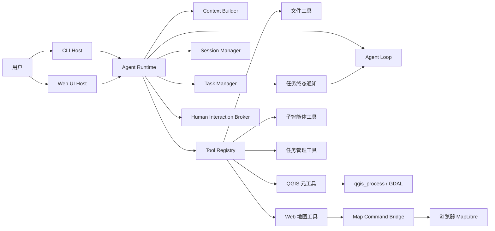

# CityBrain / Geo-agent 项目面试说明与个人贡献总结

> 文档用途：项目介绍、技术面试、简历整理、述职复盘。  
> 内容依据：当前 `E:\Geo-agent` 已落地代码。本文明确区分已实现能力、技术取舍和待完善项，不将规划内容描述为现有成果。

## 1. 一句话介绍

CityBrain 是一个面向城市空间数据分析的本地 AI Agent。它以大模型作为任务规划入口，以 QGIS Processing 和文件工具作为执行能力，同时提供 CLI 与 Web UI 两种宿主形态，使用户可以通过自然语言完成空间数据处理、查看执行过程，并在 Web 地图中交互式加载和可视化矢量、栅格结果。

## 2. 一分钟面试介绍

这个项目解决的问题是：传统 GIS 分析需要用户熟悉软件界面、算法名称、参数和数据路径，而通用大模型虽然会生成步骤，却无法可靠地执行本地空间分析。我构建了一套 TypeScript Agent Harness，把模型推理、工具调用、QGIS 算法执行、工作区安全、上下文管理、后台任务、人工确认和地图交互组织成一个完整运行时。

项目没有为数百个 QGIS 算法逐一开发工具，而是提供算法发现、参数查询和统一执行三个元工具，让 Agent 在运行时查找并组合 QGIS Processing 算法。运行层与 UI 解耦，同一个 Agent Runtime 可以运行在 CLI 或 Web UI 中；Web 模式额外获得地图状态、地图命令和可视化工作区状态，CLI 则保留终端交互能力。

在工程上，我重点解决了长任务后台化、工具并发与去重、动态 HITL、子智能体隔离、上下文压缩、空间文件坐标转换、矢量和栅格可视化，以及浏览器和 Agent 之间的状态同步。最终形成的是一个可扩展的地理空间 Agent 基础设施，而不只是一个聊天页面。

## 3. 项目定位与边界

### 3.1 项目解决什么问题

- 将自然语言空间分析需求转化为可验证的 QGIS Processing 工作流。
- 降低用户查找算法、阅读参数说明和组织中间文件的成本。
- 在本地工作区中安全地读取数据、生成过程文件和结果文件。
- 让 CLI 用户与 Web 用户共享同一套 Agent、工具和会话能力。
- 让模型感知地图视口、已加载图层、选择要素和打开的可视化组件。
- 让分析结果不仅能生成文件，还能直接进入地图完成交互式验证。

### 3.2 项目不是什么

- 不是简单调用一次 LLM API 的聊天应用。
- 不是对每一个 QGIS 算法进行硬编码封装。
- 不是完整替代 QGIS Desktop 的专业制图系统。
- 当前不是分布式任务平台；后台任务仍由本地 Node.js 进程托管。
- DEM 已支持基于 Terrain RGB、`raster-dem` 和 `setTerrain()` 的三维地形；它是高程表面渲染，不是体数据或独立分布式瓦片平台。

## 4. 技术栈

| 层级 | 技术 |
|---|---|
| 主要语言 | TypeScript、少量 QGIS/GDAL 命令参数 |
| Agent Runtime | 自研 Agent Loop、Tool Registry、Context Builder |
| 模型接入 | OpenAI 兼容模型接口、模型服务商与模型选择配置 |
| CLI | Commander、Pi 风格终端 UI |
| Web 服务 | Fastify、SSE、Node.js |
| Web 前端 | React、Vite |
| 地图 | MapLibre GL、Three.js、maplibre-gl-three、3d-tiles-renderer |
| GIS 执行 | QGIS `qgis_process`、GDAL Processing 算法 |
| 会话与日志 | JSONL、本地文件存储 |
| 并发控制 | Promise、AbortController、TaskManager、资源键调度 |
| 安全 | Workspace Sandbox、路径策略、工具权限协调、HITL |

## 5. 总体架构



### 5.1 分层职责

| 模块 | 主要职责 |
|---|---|
| Host Profile | 定义 CLI、Web、API 模式的能力、工具可见性和 Prompt 贡献 |
| Agent Loop | 模型流式调用、工具循环、结果回填、会话写入和上下文预算控制 |
| Tool Registry | 工具注册、参数执行、权限、安全检查、日志与产物管理 |
| Streaming Tool Executor | 工具调度、并行执行、事件流、前后台所有权转移 |
| Task Manager | 任务状态机、并发上限、队列、去重、资源锁、取消和通知 |
| Context Builder | 静态、动态和易变 System Prompt 的组织与缓存边界 |
| Session Manager | 会话 JSONL、消息树、上下文恢复与压缩记录 |
| Human Interaction Broker | 模型执行过程中动态暂停并向用户请求结构化决策 |
| Map Command Bridge | Agent 到浏览器地图命令的请求—响应桥接 |
| Map Layer Service | 空间文件校验、格式转换、坐标转换和地图显示缓存 |

## 6. 核心执行链路

### 6.1 普通 Agent 请求

```text
用户输入
  → Host 生成当前模式能力
  → Context Builder 拼接静态/动态/易变上下文
  → 模型返回文本或工具调用
  → Tool Registry 完成参数、安全和权限检查
  → Streaming Tool Executor 执行工具
  → 工具结果写入会话并返回模型
  → 模型继续推理或生成最终回答
```

### 6.2 QGIS 分析链路

```text
自然语言任务
  → list_qgis_algorithms 查找候选算法
  → describe_qgis_algorithm 获取真实参数定义
  → run_qgis_algorithm 执行 qgis_process
  → 持续上报进度、日志和产物路径
  → Artifact Registry 登记结果
  → Web 地图按需加载结果
```

### 6.3 Web 地图交互链路

```text
Agent 调用 map_manage_layer
  → Map Command Bridge 向当前浏览器发送 SSE 命令
  → 浏览器请求图层准备接口
  → 后端通过 QGIS/GDAL 转换数据
  → MapLibre 加载 GeoJSON 或 raster image
  → 浏览器回报命令结果和最新地图状态
  → Agent 获得可验证的执行结果
```

## 7. 项目亮点

### 7.1 CLI 与 Web UI 共用一个 UI-neutral Runtime

项目没有在 CLI 和 Web 中各写一套 Agent。`createAgentRuntime()` 统一构造模型运行时、会话、工具注册表、QGIS Runtime、任务管理器、HITL Broker 和日志组件；不同宿主只负责输入输出适配。

通过 `AgentHostProfile` 定义模式能力：

- CLI：文件、QGIS、后台任务、子智能体和终端 UI。
- Web：在公共能力上增加地图视口、图层、选择、地图命令和可视化工作区。
- API：保留未来无 UI 集成入口。

面试价值：体现依赖倒置、能力协商和多宿主架构，而不是把业务逻辑绑死在 React 或终端中。

关键代码：

- `src/runtime/create-runtime.ts`
- `src/host/agent-host-profile.ts`
- `src/cli/cli.ts`

### 7.2 不逐一封装算法，而是让 Agent 动态发现 QGIS 能力

QGIS Processing 包含大量算法，如果逐一开发工具，会造成维护成本和版本耦合。项目将能力抽象为三个元工具：

- `list_qgis_algorithms`：搜索当前 QGIS 安装实际提供的算法。
- `describe_qgis_algorithm`：读取算法参数、默认值和输出定义。
- `run_qgis_algorithm`：统一执行任意算法。

这种方式把“算法知识”从静态代码转移到运行时发现，能自动适配不同 QGIS 版本，同时让执行参数来自真实环境而不是模型记忆。

### 7.3 Claude Code 风格的长工具后台化

早期方案让模型通过 `wait_task` 轮询，实际会造成：

- 重复占用模型轮次和 token；
- 多次长轮询触发重复调用保护；
- 用户取消对话后，任务和 Agent 生命周期混乱；
- 模型可能在任务完成前消费未完成产物。

当前方案参考 Claude Code 的执行所有权转移：

1. 工具只启动一次，由 `TaskManager` 托管同一个执行实例。
2. `StreamingToolExecutor` 前台等待最多一分钟。
3. 超过阈值后标记 `detached: true`，解除前台 Run 对任务的取消绑定。
4. Agent 不再轮询，也没有 `wait_task` 工具。
5. 任务进入终态后产生 `<task-notification>`。
6. 如果模型没有新的 `tool_use`，Agent Loop 会检查本轮尚未消费的后台 taskId；仍有任务时保持 Run 活跃并在运行时内部等待。
7. 终态通知作为隐藏系统输入追加到同一个上下文，Agent 使用最终工具结果继续原任务。
8. 只有“没有新工具调用”并且“没有未消费的本轮后台任务”同时成立时，Loop 才能结束。

后台化不是“换一个 JavaScript 线程”，而是将同一个异步任务从前台等待转为事件驱动托管。QGIS 计算本身运行在独立子进程中，Node.js 负责状态与事件协调。

关键代码：

- `src/tools/core/execution/streaming-tool-executor.ts`
- `src/task/task-manager.ts`
- `src/task/task-notification.ts`
- `src/runtime/run-manager.ts`

### 7.4 TaskManager 不只是任务列表，而是一个轻量调度器

TaskManager 支持：

- `queued / running / completed / failed / cancelled / timed_out` 状态；
- 最大并发数和最大排队数；
- `AbortController` 取消传播；
- deduplication key，避免同一工具重复启动；
- resource key，避免多个任务并发写同一路径；
- 进度、产物、错误和终态事件；
- 订阅机制，供 CLI、Web RunManager 和日志系统消费。

这解决了“Promise 能异步，但无法治理”的问题。

### 7.5 动态 HITL，而不是预先写死所有确认弹窗

模型可以在意图不清、存在多种可行方案、执行具有风险或失败后需要恢复策略时，调用 `request_user_input` 动态构建交互。

已定义类型：

- `clarification`：关键信息缺失；
- `choice`：存在多种显著不同的有效方案；
- `confirmation`：执行重要操作前确认；
- `destructive_confirmation`：不可逆或高风险操作；
- `recovery_choice`：失败后需要用户选择恢复路径。

工具要求 2—8 个结构化选项、最多一个推荐项、稳定选项 ID、风险等级和超时。Web UI 将 HITL 渲染在对话流中，而不是阻断页面的浏览器弹窗。

关键代码：

- `src/tools/human-interaction/index.ts`
- `src/harness/human-interaction.ts`
- `web/src/App.tsx`

### 7.6 子智能体采用独立上下文和受限工具集

`delegate` 工具创建新的 Agent Loop 和空上下文，使子智能体不能看到主会话全部历史。主智能体必须提供完整任务描述，子智能体只能返回最终结果。

隔离措施包括：

- 新建独立 SessionManager；
- 子工具集中不注册 `delegate`，避免无限递归；
- 按 `subagent_type` 强制区分 `data-explorer`（只读文件探查）和 `spatial-planner`（只读文件与 QGIS 算法定义查询）；
- 两类均无文件写入、QGIS 处理执行、地图操作和后台任务管理工具；
- 继承主运行时的 sandbox、QGIS 配置和日志能力；
- 子过程事件不直接污染主对话，只回传最终总结和状态。

子智能体使用 `SessionManager.createTransient()` 创建纯内存会话，保持独立上下文但不生成普通 JSONL 文件，因此不会污染 Web 会话列表。工具执行与用量仍通过共享的结构化日志记录，便于诊断和审计。

关键代码：`src/tools/delegate/index.ts`。

### 7.6.1 对话后画像是后台作业，不是子智能体

项目把两类后台能力明确拆开：`delegate` 面向需要模型推理的临时子任务；工作区画像面向确定性的元数据维护，不需要新的 Agent Loop，也不应该形成会话。主 Agent 只有在一次回答完整成功后才提交画像作业，失败、中止和 transient 子智能体运行都不会触发它。

实现链路如下：

```text
主对话成功完成
  → 收集本轮新增或更新的 artifact 路径
  → 持久化 jobs/*.json
  → detached Node.js Worker
  → 文件指纹判断是否变化
  → QGIS/GDAL 或轻量解析器生成 datasets/*.json
  → 原子更新 index.json
  → 重建 Agent 可读的 citybrain/profile.md
```

这里没有用 `TaskManager` 承载最终执行，因为 `TaskManager` 服务于当前运行时中的工具生命周期；画像要求在主程序退出后仍能运行，因此采用独立进程和磁盘任务状态。两者都是后台任务，但生命周期和恢复边界不同。

为避免每轮全量扫描，正常路径只处理 Artifact Registry 报告的变化文件；首次运行或间隔达到阈值时才做轻量对账。索引使用绝对路径、大小和 `mtime` 指纹复用未变化画像，删除数据时同步移除对应 JSON。最终 `profile.md` 从小型索引重新生成，而不是重新分析所有原始数据，因此生成汇总的成本很低。

关键代码：

- `src/profile/profile-scheduler.ts`
- `src/profile/profile-service.ts`
- `src/profile/profile-store.ts`
- `src/agent/agent-loop.ts`
- `src/runtime/create-runtime.ts`

### 7.7 System Prompt 按稳定性分层

项目没有每轮无差别拼接完整 Prompt，而是分为：

- 静态层：角色、使命、工作纪律、工具语义、输出风格；
- 动态层：项目说明、长期记忆索引、技能索引；
- 易变层：当前分析任务、QGIS Runtime、后台任务、产物、地图状态、可视化状态。

收益：

- 稳定前缀有利于 Prompt Cache；
- 地图状态等高频变化内容不会污染稳定身份描述；
- CLI 不会看到不存在的 Web 地图信息；
- System Prompt 只放状态摘要，不直接塞入完整 Markdown、GeoJSON 或栅格内容。

### 7.8 上下文不是简单截断，而是分阶段降级

会话保留 canonical conversation，发送给模型前生成请求投影。上下文预算不足时按从轻到重处理：

1. 历史片段裁剪；
2. 大型旧工具结果 micro-compaction；
3. context collapse；
4. LLM 摘要压缩；
5. 摘要失败时使用确定性 fallback。

压缩结果和替换记录可追踪，避免直接破坏持久会话。

### 7.9 Workspace Sandbox 与工具前置检查

工作区将用户项目目录与 Agent 管理目录分离：

```text
project/
├─ 用户原始数据
└─ citybrain/
   ├─ artifacts/process
   ├─ artifacts/result
   └─ .internal/logs
```

工具执行前会处理：

- 读取路径是否在允许目录；
- 写入路径是否在工作区；
- Harness 内部文件是否禁止通用工具修改；
- 已有文件是否完成 read-before-write；
- 破坏性操作是否需要确认；
- 产物路径是否在完成后真实存在。

说明：当前是应用层路径策略，不等价于操作系统容器或账户级隔离。

### 7.10 Agent 与地图形成闭环，而不是单向生成文件

Web 模式下，Agent 能够：

- 读取当前地图视口、图层、显隐和选择状态；
- 添加、移除、更新图层；
- 调整视口或缩放到图层；
- 检查矢量字段和数据分布；
- 执行简单、分类、分级矢量可视化；
- 执行栅格灰度、RGB、分级设色、山体阴影和 DEM 三维地形可视化；
- 加载带显式地理位置的 glTF、GLB、OBJ 独立模型，以及本地或远程 3D Tiles。

地图命令通过 SSE 发往当前浏览器，浏览器执行后把结果返回 Bridge。工具只有收到浏览器确认才算完成，避免模型“声称地图已经变化”但前端实际没有执行。

### 7.11 支持非 4326 矢量和常见栅格格式

矢量链路：

```text
SHP/GPKG/KML/GML
  → QGIS native:reprojectlayer
  → EPSG:4326 GeoJSON 缓存
  → MapLibre GeoJSON source
```

栅格链路：

```text
GeoTIFF/VRT/IMG/ASC
  → gdal:warpreproject
  → EPSG:4326 中间栅格
  → PNG + world file
  → 计算四角坐标
  → MapLibre image source + raster layer
```

栅格符号化会基于原始重投影栅格重新生成显示缓存，并通过版本化 URL 热更新前端，不修改原始文件。

DEM 三维链路：

```text
DEM
  → QGIS 重投影为 EPSG:3857 高程栅格
  → 后端按 XYZ 请求读取并重采样高程窗口
  → Mapbox Terrain RGB 编码与磁盘缓存
  → MapLibre raster-dem + setTerrain()
  → 地形网格、山体阴影与倾斜视角
```

该链路不生成另一份永久业务数据，只在工作区 `.internal/map-cache` 中维护可重建的显示缓存；垂直夸张仅由前端渲染参数控制，不会重复转换 DEM。

三维模型链路：

```text
本地/远程 glTF、GLB、OBJ
  → 工作区安全校验或 HTTP(S) URL 校验
  → Three.js Loader
  → 经纬度/高程转换为 ECEF 变换矩阵
  → MapLibre Custom Layer 与地图相机同步渲染

本地/远程 tileset.json
  → 3d-tiles-renderer 按需调度层级瓦片
  → maplibre-gl-three 同步地图相机与空间坐标
```

本地模型的关联纹理、二进制缓冲和嵌套 tileset 通过受限资源接口提供，接口会再次校验资源仍位于登记的资产根目录，防止路径穿越。独立模型通常不带可靠地理参考，因此添加时必须提供经纬度；3D Tiles 则优先使用自身的空间参考。

### 7.12 Web UI 是空间工作台，而不是普通聊天页

Web UI 采用：

- 左侧：会话列表 / 项目目录切换、工作区文件和设置入口；
- 中间：不可移除的地图和可关闭的 Markdown、HTML、CSV、JSON、文本、图片标签页；
- 右侧：Markdown 对话、工具执行卡片、后台任务状态和内联 HITL；
- 设置页：模型服务商、API、模型、Agent、QGIS、地图、界面等分模块设置。

图层准备或栅格渲染期间，按钮、地图顶部和图层面板都会显示 loading，避免长请求看起来像页面失效。

## 8. 关键难点、方案和取舍

### 8.1 难点：长工具既不能阻塞 Agent，也不能重复执行

错误思路是超时后重新提交任务，或者让模型不停调用等待工具。这样容易产生重复副作用和轮询风暴。

最终方案是同一任务实例的所有权转移：阈值前由前台 Run 持有，阈值后由 TaskManager 持有。转移时删除前台 abort listener，任务完成后通过事件主动回注。

面试关键词：single execution、ownership transfer、push notification、cancellation boundary、idempotency。

### 8.2 难点：浏览器状态与后端状态容易出现双真相

地图真正是否加载成功，只有浏览器 MapLibre 知道；后端登记成功不代表前端 source 已创建。因此地图状态以浏览器上报为准，Map Command Bridge 使用 `sessionId + clientId` 绑定活动客户端，命令执行完成后返回结果。

同时在 React 状态更新尚未提交时，使用 `artifactsRef` 维护命令侧即时图层注册表，避免 `add → inspect/visualize` 连续调用找不到刚添加的图层。

### 8.3 难点：空间数据格式和坐标系不能直接交给浏览器

MapLibre 原生最适合 Web Mercator 底图、WGS84 GeoJSON 和 Web 影像源，而用户数据可能是任意 CRS 的 SHP、GPKG 或 GeoTIFF。

项目把“分析数据”和“显示数据”分离：保留原始文件，在 `.internal/map-cache` 生成显示缓存。矢量转为 EPSG:4326 GeoJSON；栅格重投影后生成 PNG 和空间四角坐标。

取舍：当前栅格使用整幅 image source，适合中小数据快速显示；超大栅格应升级为瓦片金字塔和按需切片服务。

### 8.4 难点：矢量和栅格的可视化语义完全不同

矢量围绕要素属性字段组织：简单、分类和数值分级。栅格围绕波段和像元值组织：灰度拉伸、RGB 合成、色带和阴影。

项目在模型侧保留统一的 `map_manage_layer`，减少工具数量；在参数层通过 `operation` 和 `visualization.mode` 区分，在执行层根据图层类型路由到矢量 MapLibre Paint 或后端 QGIS/GDAL 渲染。

### 8.5 难点：System Prompt 需要感知 UI，但不能塞完整文件

如果把完整 Markdown、GeoJSON 或表格塞入 System Prompt，会造成 token 膨胀和缓存失效。项目只注入元数据状态：当前标签页、文件类型、路径、活动视图、地图范围、图层摘要和选择摘要。真正内容由工具按需读取。

### 8.6 难点：HITL 不能退化成到处弹窗

HITL 只有在缺少信息会改变方案或存在风险时才调用，并且必须提供有限、互斥、可解释的选项。Web 端将其视为 Run 的一种等待状态，嵌入对话消息流，用户回答后原 Agent Generator 继续执行。

### 8.7 难点：Windows 下可靠执行 QGIS

QGIS 经常通过 `.bat` 配置 OSGeo4W 环境，但直接经 `cmd %*` 转发包含空格的参数容易出现转义问题。项目先调用 wrapper 捕获环境变量，再直接启动真实 `qgis_process.exe`，保留可靠的 Node 参数传递；无法解析时才回退到 bat。

## 9. 我的贡献清单

以下内容可以作为面试中的第一人称贡献表述。

### 9.1 架构与运行时

- 我将 Agent 核心从 CLI 中抽离为 UI-neutral Runtime，使 CLI 与 Web UI 复用同一个 Agent Loop、工具系统、会话、任务和权限模型。
- 我设计了 Host Profile 和 Capability 机制，使不同模式拥有不同的工具集合和 System Prompt，而不是依靠前端隐藏按钮。
- 我建立了运行时事件协议，通过 SSE 将模型增量、工具状态、任务通知和 HITL 状态传递给 Web UI。

### 9.2 工具执行与可靠性

- 我抽象了统一 Tool Registry 和工具元数据，集中处理只读性、破坏性、并发安全、输入输出路径、取消行为和结果大小。
- 我实现了流式工具执行器，使模型文本、thinking、工具生命周期和进度事件可以统一输出。
- 我实现了工具调用去重和资源键冲突控制，避免相同任务重复执行或多个任务同时写同一结果路径。
- 我分析真实日志定位 `wait_task` 轮询问题，并参考 Claude Code 改为同一执行实例的前后台所有权转移。
- 我移除了模型侧 `wait_task`，改为任务终态事件主动回注 Agent，降低无效模型轮次并理清取消边界。
- 我将耗时工具后台升级阈值设置为一分钟，并保留用户主动查询、取消和列出任务的能力。

### 9.3 QGIS 与空间数据

- 我完成了 QGIS Runtime 检测、路径配置、版本验证以及 Web 设置页的真实配置联动。
- 我没有手工封装数百个算法，而是实现算法发现、算法描述和统一执行的元工具体系。
- 我完善了 Windows QGIS 子进程调用、环境捕获、超时、取消、进度和输出路径校验。
- 我实现了 SHP、GPKG、KML、GML 到 WGS84 GeoJSON 的地图显示链路。
- 我实现了 GeoTIFF、VRT、IMG、ASC 的栅格重投影、PNG 缓存、世界文件解析和四角坐标计算。
- 我扩展统一地图工具，使栅格支持灰度、RGB、分级设色和山体阴影，并完成真实 QGIS 端到端验证。
- 我实现了 DEM Terrain RGB 按需切片与真实高程地形渲染，并把垂直夸张保留为前端渲染参数。

### 9.4 Web GIS 交互

- 我构建了左侧会话/项目目录、中间地图/多模态标签页、右侧问答的空间工作台布局。
- 我实现了 Agent 到浏览器地图的命令桥，以及浏览器到 Agent 的地图状态回报。
- 我解决了连续 `add → inspect → visualize` 时 React 状态提交延迟导致图层找不到的问题。
- 我实现了地图图层添加、移除、显隐、透明度、视口控制和矢量专题图。
- 我接入 Three.js、maplibre-gl-three 与 3d-tiles-renderer，使 Web 地图支持 glTF、GLB、OBJ 和 3D Tiles，并处理 ECEF 定位、关联资源安全服务和图层生命周期。
- 我为长时间图层准备和栅格渲染补充了按钮、地图和图层面板三级 loading 状态。
- 我实现了 Markdown 消息渲染、工具消息就地排列、会话删除/清空和自定义确认弹窗。

### 9.5 Agent 能力

- 我实现了动态 HITL 工具及其分类、风险、结构化选项、超时和 CLI/Web 展示。
- 我实现了子智能体委派、空上下文隔离、受限工具集和最终结果回传。
- 我将子智能体会话改为纯内存 transient session，避免内部执行记录被 Web 扫描成普通用户对话。
- 我实现了对话后独立画像 Worker：按本轮产物增量提取矢量、栅格、表格、文档和三维数据元信息，以结构化 JSON 维护内部状态，并自动投影为 Agent 可读的 `profile.md`。
- 我将画像作业与子智能体、运行时内 TaskManager 分离，通过独立进程、磁盘队列、文件锁和启动恢复保证主对话不阻塞、前台退出后仍可继续且不产生普通会话。
- 我将地图状态和多模态标签页状态作为 Web 模式易变上下文注入，而不是污染 CLI 模式。
- 我实现了上下文使用记录、请求投影、大结果压缩和会话恢复基础能力。

### 9.6 安全与可观测性

- 我建立了项目级 Workspace Sandbox、读写路径检查和内部管理文件保护。
- 我建立了工具执行、上下文使用、实际模型请求 trace 和后台任务生命周期日志。
- 我实现了统一观测聚合层，以 `runId / taskId / toolCallId` 关联模型、工具、任务、HITL、产物和错误，计算 Token、成功率、平均/P95 耗时等指标。
- 我同时提供 CLI `/observe` 多视图命令和 Web 设置页观测面板；面板支持 Run 筛选、活动任务、时间线与自动刷新，并避免向浏览器暴露完整 Prompt 正文。
- 我将产物状态与任务状态关联，防止 Agent 提前消费未完成文件。

## 10. 可直接用于简历的项目描述

### 10.1 精简版

**CityBrain：面向城市空间分析的本地 AI Agent**  
基于 TypeScript、React、Fastify、MapLibre、Three.js 与 QGIS Processing 构建支持 CLI/Web 双模式的空间分析 Agent；设计统一 Tool Harness、动态 HITL、子智能体、上下文压缩和 Claude Code 风格后台任务机制；实现 SHP/GPKG/GeoTIFF 等数据的坐标转换、AI 驱动专题可视化、DEM 地形和 3D Tiles/三维模型加载。

### 10.2 简历要点版

- 设计 UI-neutral Agent Runtime 与 Host Capability 体系，在 CLI/Web 两种宿主间复用模型、会话、工具、任务和权限能力，并按模式动态组装工具与 System Prompt。
- 构建 QGIS 元工具体系，通过运行时算法发现、参数查询和统一执行替代数百个算法的手工封装，支持进度、取消、产物校验和 Windows QGIS 环境适配。
- 参考 Claude Code 实现长工具执行所有权转移，移除模型轮询式 `wait_task`，使用终态事件主动回注 Agent，并通过去重键和资源键治理重复执行与写冲突。
- 实现 Agent—Web 地图双向命令桥，支持地图状态感知、矢量专题图、GeoTIFF 栅格渲染、DEM 地形，以及 glTF/GLB/OBJ 与 3D Tiles 三维场景加载。
- 设计结构化动态 HITL，将澄清、方案选择、风险确认和失败恢复嵌入 CLI/Web 对话执行流。

## 11. 高频面试问题与参考回答

### Q1：为什么不用 LangChain/LangGraph，为什么自研 Harness？

项目的关键不只是串联模型和工具，而是需要精确控制工具生命周期、QGIS 子进程、路径权限、任务后台化、地图客户端状态和上下文投影。自研 Harness 能让取消边界、事件协议、产物状态和日志结构保持一致。代价是需要自己维护调度和上下文逻辑，因此我把模块拆为 Agent Loop、Tool Registry、TaskManager 和 Host Adapter，控制复杂度。

### Q2：为什么不为每个 QGIS 算法写一个工具？

QGIS 算法数量大且不同版本存在差异。逐一封装维护成本高，模型仍可能使用错误参数。通过 list、describe、run 三个元工具，模型先从本机发现算法，再读取真实参数定义，最后统一执行，能适配版本并减少静态代码。

### Q3：后台运行是不是换了线程？

不是。TaskManager 托管同一个 Promise 和 AbortController，超过一分钟后只发生前台所有权转移。Node 主线程仍负责异步事件，QGIS 计算实际位于独立子进程。纯 JavaScript CPU 密集任务如果出现，仍需要 Worker Thread 或独立进程。

### Q4：为什么删除 `wait_task`？

模型轮询会浪费 token、占用模型轮次、触发重复调用保护，并让任务取消语义复杂。现在由 Agent Loop 在代码层等待本轮关联的 Task Promise；这个等待不调用大模型。任务结束后只把一次终态结果回注同一个上下文，使模型只处理一次最终结果。

### Q5：如何避免一个工具被重复执行？

对工具名、规范化参数和执行作用域计算 deduplication key。活动任务存在时复用它；只有任务真实完成或失败后才释放 key。涉及文件写入时还使用 resource key 避免写冲突。

### Q6：如何保证后台任务不会被前台取消误杀？

前台阶段 Run 的 AbortSignal 会桥接到 TaskManager；一旦超过阈值并完成 ownership transfer，就移除该监听器并标记 detached。之后取消对话不会终止后台任务，显式 `cancel_task` 仍可以取消。

### Q7：Web 模式和 CLI 模式有什么本质区别？

不只是 UI 不同。Host Profile 决定模型能看到的工具和上下文。Web 模式有地图命令、地图状态和标签页状态；CLI 明确告诉模型没有浏览器地图。工具列表是最终权威，避免模型在 CLI 中虚构地图操作。

### Q8：地图状态为什么不全部放进 System Prompt？

只放视口、图层和选择摘要。完整数据体积大、变化频繁，会增加 token 并破坏缓存。需要字段或内容时通过 `map_inspect_layer`、文件工具等按需获取。

### Q9：地图图层为什么需要后端接口？显隐不能只在前端做吗？

显隐和透明度本身可以在前端完成，但 Agent 也要操作并感知它们，且 SHP/GPKG/GeoTIFF 需要后端读取、转换和安全校验。因此前端负责渲染，后端负责数据准备和权威元数据，浏览器再回报真实渲染状态。

### Q10：如何解决非 EPSG:4326 数据？

保留原始分析数据，生成独立显示缓存。矢量通过 `native:reprojectlayer` 转为 EPSG:4326 GeoJSON；栅格通过 `gdal:warpreproject` 重投影，再生成带 world file 的 PNG，由后端计算四角坐标交给 MapLibre。

### Q11：为什么栅格不直接在浏览器读取 GeoTIFF？

浏览器直接解析需要额外 GeoTIFF、CRS 和投影定义支持，而且大栅格会造成网络和内存压力。当前利用已有 QGIS/GDAL 保证格式与投影兼容，前端只消费可显示影像。后续大数据应升级为瓦片服务，而不是传整幅 PNG。

### Q12：矢量与栅格为什么共用一个工具？

模型侧工具过多会增加选择成本。统一 `map_manage_layer` 后，通过 `operation` 与 `visualization.mode` 表达意图；执行端根据图层类型分流。这样保持接口收敛，同时不强行复用两套不同的渲染算法。

### Q13：动态 HITL 如何避免模型滥用？

System Prompt 明确只有缺少信息会改变方案或存在风险时才调用；工具 schema 限制选项数量、推荐项数量和风险类型；权限层的破坏性确认与模型主动澄清共用 Broker，但保留不同 kind 和 phase，便于审计。

### Q14：子智能体如何避免无限递归？

子智能体使用按类型构建的独立 Tool Registry：`data-explorer` 仅有 `list_files`、`read_file`，`spatial-planner` 另有 QGIS 算法列表与描述工具；两者都不注册 `delegate` 或执行/写入工具。因此无法继续创建子智能体，也无法修改数据。同时子智能体从空会话开始，主 Agent 必须提供自包含任务。

### Q15：为什么子智能体不形成普通会话？

委派执行使用 `SessionManager.createTransient()`，消息只保存在当前子代理实例的内存中，不创建可恢复 JSONL，因此 Web 会话扫描天然看不到它。子代理仍共享工具执行日志和上下文用量日志，既避免用户会话列表被内部执行污染，也保留必要的可观测性。若未来需要恢复长时间子任务，可另建具有 `kind` 和 `parentSessionId` 的内部持久会话，而不是退回普通用户会话。

### Q16：为什么数据画像不是子智能体或普通 TaskManager 任务？

画像是确定性的维护工作，不需要 LLM 推理，因此创建 Agent Loop 和对话只会增加 token、会话污染与生命周期耦合。普通 TaskManager 负责当前 Node.js 运行时中的工具执行，进程退出后不能继续托管；画像则先持久化任务，再启动 detached Worker，使用工作区文件锁串行消费队列。这样主回答不等待画像，Worker 不创建会话，异常退出后也能从 `jobs/*.json` 恢复。

### Q17：如何做可观测性？

我把观测分成采集、关联、聚合和呈现四层。工具执行、进度、产物、失败、HITL 和 Agent 状态进入 `tool-execution.jsonl`；上下文 Token 进入 `context-usage.jsonl`；真实请求、消息投影和压缩报告进入 `context-trace.jsonl`；后台任务生命周期进入 `task-events.jsonl`。统一的 `AgentObservabilityService` 再以 `runId / taskId / toolCallId` 关联这些事件，生成 Run、模型、工具、任务、HITL、产物、错误等维度的指标和时间线。

呈现层不侵入 Agent Loop：CLI 使用 `/observe summary|runs|tools|errors|timeline`，Web 在“设置 → 可观测性”中显示 Token、平均模型延迟、工具成功率、P95、活动任务和最近事件，并可按 Run 筛选和自动刷新。完整 Prompt 只保存在本地 trace 日志，Web API 只返回聚合结果与截断摘要；读取层对超大 trace 采用有上限的尾部读取并显式返回 `loadedBytes / truncated`，避免观测刷新反过来阻塞 Agent 主事件循环。

### Q18：最大的工程取舍是什么？

当前优先做本地单进程可运行闭环，因此 TaskStore 默认内存实现、Web 地图使用整幅影像、Sandbox 是应用层策略。它们降低 MVP 复杂度，但进程重启恢复、超大栅格和强隔离仍需要持久队列、瓦片服务与进程/容器级执行器。

## 12. 推荐演示流程

1. 启动项目，展示 CLI/Web 模式选择。
2. 在 Web 新建会话并选择真实项目目录，说明不会默认创建指向仓库的会话。
3. 展示模型、QGIS 和地图设置。
4. 请求 Agent 查找并描述一个 QGIS 算法。
5. 运行一个空间处理任务，展示工具流、日志和产物。
6. 将非 4326 矢量加载到地图，展示自动转换。
7. 连续执行图层添加、检查和分级可视化。
8. 加载 DEM/GeoTIFF，切换灰度、分级设色或山体阴影。
9. 展示图层准备 loading、显隐、透明度和缩放。
10. 构造一个需要方案选择的需求，展示对话内动态 HITL。
11. 解释超过一分钟的 QGIS 工具如何后台化并自动回注结果。

## 13. 当前限制与后续优化

| 当前限制 | 影响 | 后续方案 |
|---|---|---|
| TaskManager 默认内存存储 | 进程退出后 runner 无法恢复 | 持久化任务队列、worker lease、启动恢复策略 |
| 栅格使用整幅 PNG image source | 超大栅格加载和显存压力较大 | COG、XYZ/WMTS 瓦片、金字塔缓存 |
| DEM 瓦片由本地进程按需生成 | 首次浏览未缓存区域存在计算开销，难以直接横向扩容 | COG/预生成金字塔、独立瓦片服务、共享缓存 |
| 单体三维模型由浏览器完整加载 | 大模型会占用网络、内存和 GPU，缺少层级细节 | 大场景转换为 3D Tiles、压缩纹理和几何、按需加载 |
| 远程三维资源依赖 CORS，独立模型缺少统一地理参考 | 资源服务器配置或定位参数错误会导致加载失败、位置偏移 | 资源代理、CORS 诊断、模型地理配准与定位预览 |
| 栅格 inspect 元数据有限 | AI 对波段语义判断不足 | GDAL JSON metadata、波段统计、NoData、数据类型扫描 |
| Sandbox 为应用层策略 | 无法抵御进程级恶意行为 | 独立系统账户、容器、受限 worker |
| Web 主包体积较大 | 首次加载成本偏高 | React/MapLibre 动态导入和代码分包 |
| 地图与任务状态主要在进程内 | 多实例部署困难 | Redis/数据库状态、消息总线、客户端租约 |

## 14. 面试表达注意事项

- 不要把项目描述为“调用 ChatGPT 加一个地图”。重点是执行 Harness、GIS Runtime 和状态闭环。
- 不要说后台化是“新开线程”；应解释执行所有权转移与 QGIS 子进程。
- 不要说支持所有空间格式；列出当前真实支持格式。
- 可以说明已实现 DEM 三维地形、轻量独立模型和 3D Tiles，但要准确限定为浏览器三维场景加载与交互，不要描述成完整数字孪生编辑平台或分布式瓦片平台。
- 不要回避限制。能准确说明 transient subagent、持久任务和瓦片化方向，会比泛化宣传更有说服力。
- 回答设计问题时尽量使用“问题—约束—方案—取舍—验证”结构。

## 15. 代码索引

| 主题 | 代码位置 |
|---|---|
| Runtime 组装 | `src/runtime/create-runtime.ts` |
| Host 能力与模式 Prompt | `src/host/agent-host-profile.ts` |
| Agent Loop | `src/agent/agent-loop.ts` |
| System Prompt | `src/context/context-builder.ts` |
| 上下文投影与压缩 | `src/context/` |
| 工具注册与执行 | `src/tools/core/` |
| 流式工具与后台升级 | `src/tools/core/execution/streaming-tool-executor.ts` |
| 后台任务管理 | `src/task/task-manager.ts` |
| 任务完成通知 | `src/task/task-notification.ts` |
| 动态 HITL | `src/tools/human-interaction/index.ts` |
| 子智能体 | `src/tools/delegate/index.ts` |
| QGIS 进程客户端 | `src/integrations/qgis/qgis-process-client.ts` |
| 地图工具 | `src/tools/map/index.ts` |
| 地图命令桥 | `src/runtime/map-command-bridge.ts` |
| 地图状态 | `src/runtime/map-state-store.ts` |
| 矢量/栅格准备 | `src/adapters/web/map-layer-service.ts` |
| Web API | `src/adapters/web/web-server.ts` |
| Web 地图 | `web/src/MapPanel.tsx` |
| Web 主界面 | `web/src/App.tsx` |
| Web 设置 | `web/src/SettingsPage.tsx` |
| CLI | `src/app/interactive-app.ts` |
| Workspace Sandbox | `src/workspace/` |
| 会话管理 | `src/session/session-manager.ts` |

## 16. 最终总结

项目最有价值的部分不是单个页面或某一个 QGIS 算法，而是建立了一套可以持续扩展的空间 Agent 运行基础：同一个 Runtime 可以服务不同宿主，工具具备生命周期与安全契约，长任务可以无轮询后台化，模型可以动态请求人类决策，地图与 Agent 之间形成可验证的双向闭环，空间数据经过确定性的投影与格式转换后进入 Web 可视化。

如果面试官继续追问，最值得深入展开的三个主题是：

1. 长工具从前台到后台的所有权转移与取消边界；
2. Agent、后端与浏览器地图之间如何避免状态双真相；
3. 如何用 QGIS 元工具和上下文分层控制系统复杂度。
